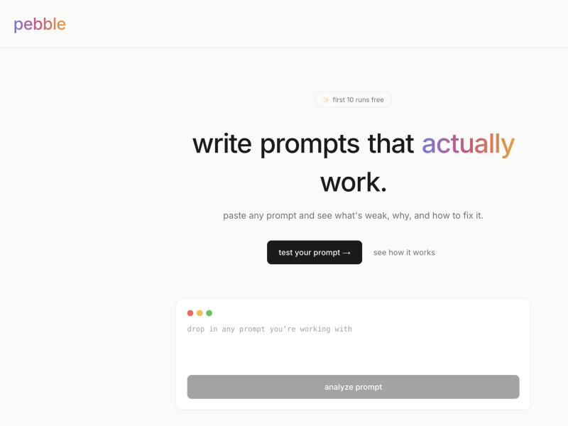
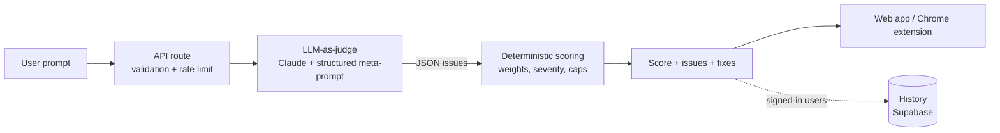

  

<h1 align="center">Pebble: Prompt Linter</h1>

  <b>Paste any prompt and see what's weak, why, and how to fix it.</b> 
  A linter for AI prompts, available as a web app and a Chrome extension for Claude, ChatGPT and Gemini.

  
  
  

  

> **Note:** Pebble's source code is private. This repository documents what it does and how it's built.

## Why

Most people's AI results are inconsistent because their prompts are missing structure: no role, an unclear task, no output format, no constraints. Pebble catches those gaps before you hit send, the way a code linter catches bugs before you run the code.

## Features

- **Prompt analysis:** flags issues by severity (critical, important, minor), quotes the exact problem text, explains why it matters and suggests a concrete fix
- **Quality score (0–100):** a single number with a verdict, from *rewrite recommended* to *ready to ship*
- **Context-aware checks:** adapts to the prompt type (chatbot system prompt, one-off task, creative or code) and to whether it starts a new conversation or is a follow-up mid-conversation
- **Prompt generator:** describe what you want and get a structured, production-ready prompt back
- **Chrome extension:** lint prompts inline and insert generated prompts directly on claude.ai, chatgpt.com and gemini.google.com
- **Accounts and history:** sign in to keep a history of your analyses

## How it works

Pebble uses a **two-layer design**: an LLM judges the prompt's meaning, then deterministic code turns those judgments into a consistent score.

1. **LLM-as-judge.** A structured meta-prompt has Claude classify the prompt type and conversation mode, then check for the framework elements that type needs: role, task, context, output format, constraints and examples. It also catches vague instructions and contradictory constraints. The output is strict JSON: category, severity, quoted text, explanation and suggestion.
2. **Rule-based scoring.** Code, not the model, computes the score. Each issue is weighted by category and severity, grouped into families (structure, clarity, context, output, behavioral, examples) with per-family caps so one weakness can't sink the whole score. Longer, more effortful prompts get a small bonus. This keeps scores stable and explainable across runs.

## Tech stack

| Layer | Tools |
|---|---|
| Frontend | Next.js 14, React, TypeScript, Tailwind CSS, Framer Motion |
| AI | Anthropic Claude API |
| Backend | Next.js API routes on Vercel |
| Auth and data | Supabase (auth, analysis history) |
| Rate limiting | Vercel KV (Redis) |
| Extension | Chrome Manifest V3 (content scripts + service worker) |
| Email | Resend |

## Research

Pebble is the subject of my bachelor thesis at **SRH University Berlin** (2027) on **LLM prompt quality evaluation systems**.

## Author

**Dani Kabbani**: [LinkedIn](https://linkedin.com/in/dani-kabbani) · [GitHub](https://github.com/DaniKabbani)
